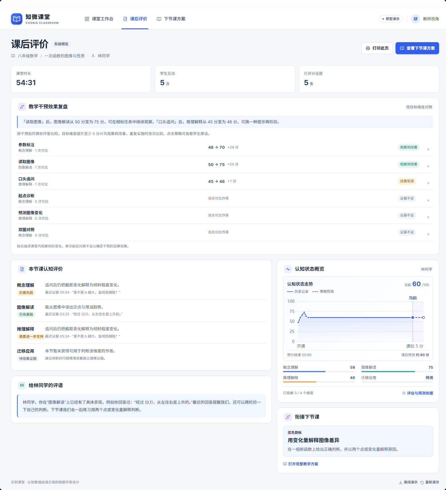

# 知之课堂 — 页面开发文档

> **当前任务**：依据最新设计图调整【课堂工作台】、【课后评价】、【下节课方案】三个核心页面的 UI 布局与业务联动。

---

## 一、全局规范与公共模块

### 1. 基本信息与上下文示例
- **站点名称**：知之课堂
- **课程示例上下文**：八年级数学《一次函数的图像与性质》
- **学生示例**：林同学（授课数字人：周老师）
- **端侧适配**：桌面端工作台优先，固定左右分栏布局，**不做移动端适配**。

### 2. 视觉与 UI 规范
- **整体风格**：现代 B 端教育 SaaS 后台风格，白色背景，浅灰分割，卡片圆角 + 轻微阴影，干净轻量化，无花哨动效，信息层级清晰。
- **色彩体系**：
  - **主色调**：`#1677ff`（标准蓝）
  - **状态标签色标**：
    - 绿色：正向反馈 / 观测到改善 / 独立解释
    - 蓝色：常规引导 / 只给结论
    - 浅橙色 / 黄色：预警 / 改善有限 / 出现混淆 / 学生认知标签
    - 灰色：中性状态 / 证据不足 / 待观测
- **图表组件**：采用 ECharts 或 AntV 实现折线图与横向进度条。
- **打印支持**：【课后评价】与【下节课方案】需支持一键打印，适配纸质教研复盘、备课及家校反馈场景。

### 3. 全局公共组件
- **顶部全局导航栏**：
  - **左侧**：品牌 Logo【知之课堂】
  - **中部导航 Tab**：`课堂工作台` ｜ `课后评价` ｜ `下节课方案`
  - **右侧全局视角切换**：`原型演示`、`教研视角`（各页面专属操作按钮详见对应章节）
- **底部全局操作区**（右下角）：
  - `离线演示`、`重新演示`

### 4. 核心业务数据闭环
三个页面构成完整的教学数据闭环：
> **课堂工作台**（实时采集师生互动 + 实时计算认知分 + 触发干预策略）  
> $\rightarrow$ **课后评价**（汇总课堂证据 + 干预效果复盘打分 + 生成学情评语 + 输出下节课目标）  
> $\rightarrow$ **下节课方案**（基于薄弱认知点自动生成针对性短课时教案、时间规划与课堂分支预案）

---

## 二、页面一：课堂工作台（核心授课页）

- **设计参考图**：
  
- **页面状态**：课堂【进行中】
- **顶部专属操作按钮**：`结束课堂`、`学生互动`、`模拟下一轮`
- **整体布局**：左右两栏卡片布局（左侧主内容区约占 70%，右侧信息面板区约占 30%）。

### 1. 左侧主内容区（占宽 70%，上下 2 张独立卡片）

#### 卡片 1：数字人课堂（核心授课区）
- **标题栏**：`数字人课堂`，右上角提供【同步板书】按钮。
- **顶部信息条**：讲师标识（`数字人 - 周老师`）、课堂计时（如 `54:18`）。
- **主播放容器**（深色黑板绿背景，模拟线上黑板授课）：
  - 内嵌数字人讲师半身画面（支持授课手势）与板书内容（公式、坐标系、函数图像、标题文字）。
  - 底部叠加：课堂讲解状态条、**当前提问文本**（高亮展示抛给学生的当前问题）。
- **视频控制栏**：暂停、切帧、全屏播放控件。

> **⚠️ 对接锁定要求（重点）**：  
> 数字人课堂模块**保持现有对接逻辑不变**，数字人 SDK / 推流、板书同步逻辑均沿用当前方案，仅按新设计图调整 UI 布局及周边配套面板，**不改动底层对接模式**。

#### 卡片 2：课堂互动记录
- **标题栏**：`课堂互动记录`，右上角显示互动统计（如 `5 次学生互动`）。
- **对话流区域**：聊天式时序对话流，按时间正序/倒序展示师生一问一答记录。
  - 单条消息结构：发言人（学生 / 老师）+ 时间戳 + 消息正文 + 学生状态标签（如「概念混淆」）。
- **底部输入区**：输入框（Placeholder：`以学生身份回答或提问...`）+【互动】提交按钮，用于模拟学生输入并发起课堂交互。

### 2. 右侧信息面板区（占宽 30%，上下 2 张独立卡片）

#### 卡片 1：实时认知状态
- **标题栏**：`实时认知状态`，右上角显示学生标识（`林同学`）。
- **认知状态走势折线图**：
  - 图例：实线 = 历史记录，虚线 = 策略预测。
  - 坐标轴：横轴（开课 $\rightarrow$ 课后 5 分），纵轴（`0-100` 分值）。
  - 关键标注：【当前分数】、课后预测分数；图表下方小字展示「预计结束课堂时间」。
- **多维度认知分项进度条**：概念理解、图像解读、推理解释、迁移应用（标注「待观测 / 已观测」状态）。
- **底部链接**：`评估与预测依据`（附带展示已观测维度数量）。

#### 卡片 2：实时教学干预
- **标题栏**：`实时教学干预`，右上角显示状态标签【已切换】。
- **主体内容**：
  - **触发来源**：如「由『口头追问』切换至」。
  - **策略内容**：干预策略标题 + 干预说明文本（如双图对照的教学引导思路）。
  - **决策依据**：说明系统触发该条干预策略的原因。
- **底部链接**：`策略记录`（点击查看历史干预记录）。

### 3. 页面内数据联动规则
`数字人课堂抛出提问` $\rightarrow$ `学生在【课堂互动记录】提交回复` $\rightarrow$ `后端计算认知指标，刷新【实时认知状态】图表与进度条` $\rightarrow$ `系统匹配教学规则，自动生成或切换【实时教学干预】策略`。

---

## 三、页面二：课后评价（复盘报告页）

- **设计参考图**：
  
- **页面定位**：偏教研复盘与数据报告风格，课后自动汇总证据生成报告。
- **顶部专属操作按钮**：`打印此页`、`查看下节课方案`
- **整体布局**：顶部汇总信息行 + 下方左右两栏卡片布局。

### 1. 顶部汇总信息行（3 个并排指标块）
1. **课堂时长**：如 `54:31`
2. **学生互动**：如 `5 次`
3. **已评分证据**：如 `5 条`

### 2. 左侧主区域（3 张卡片纵向排列）

#### 卡片 1：教学干预效果复盘
- **标题栏**：`教学干预效果复盘`，右侧小字提示「按目标维度对照」。
- **复盘摘要**：文本描述上一轮教学干预策略、干预前后指标变化及观测结论。
- **参数标注对比表格**：按干预策略逐行展示（如：读取图像、口头追问、配点诊断、预测图像变化、双图对照），包含字段：
  - 干预名称、触发次数
  - 分数变化（原分 $\rightarrow$ 目标分 + 增量）
  - 状态标签：**观测到改善**（绿）/ **改善有限**（黄）/ **证据不足**（灰），每行带下拉箭头支持展开查看详情。

#### 卡片 2：本节课认知评价
- 按 4 个认知维度分行展示：`概念理解`、`图像解读`、`推理解释`、`迁移应用`。
- **单维度统一结构**：
  - 维度标题 + 状态标签（`仍需巩固` / `已有基础` / `需要进一步支持` / `待收集证据`）。
  - 正文详情：清晰区分展示**学生课堂原话 / 典型作答**与**系统观测结论 / 后续采集建议**，方便教师溯源。

#### 卡片 3：给林同学的评语
- 独立文本框，展示面向学生的自然语言个性化评语，涵盖本节课优势、现存问题及下节课学习方向。

### 3. 右侧面板（2 张卡片纵向堆叠）

#### 卡片 1：认知状态概览
- 与【课堂工作台】右侧「实时认知状态」组件结构一致，展示本节课最终沉淀结果：
  - 学生标识（`林同学`）
  - 认知状态走势折线图（实线历史、虚线预测、当前分、课后预测分、预计结束时间）
  - 4 维度分项进度条 + 已观测维度数量
  - 底部链接：`评估与预测依据`

#### 卡片 2：衔接下节课
- **优先目标标题**
- **目标描述文本**：总结本节课遗留缺口及下节课核心学习任务。
- **跳转按钮**：【打开完整教学方案】（点击切换至「下节课方案」Tab）。

---

## 四、页面三：下节课方案（个性化教案页）

- **设计参考图**：
  
- **页面定位**：承接【课后评价】的学情数据，自动生成个性化短课时教案与课堂分支预案。
- **顶部专属操作按钮**：`打印此页`、`查看评价`
- **整体布局**：左右两栏卡片布局。

### 1. 左侧区域（2 张卡片纵向排列）

#### 卡片 1：下一节课的教学思路
- **优先目标**：维度标识（如 `推理解释`）+ 目标标题【用变化量解释图像差异】。
- **目标说明**：在一组新函数上给出正确判断，并以两个点或变化量解释原因。
- **教学思路文本**：从本节课的回答出发，先用一道新题确认学生的起点，再根据解释的完整性决定是否提供提示。

#### 卡片 2：20 分钟教学安排（时序课时拆解）
- 采用时间轴形式展示，左侧使用**圆点**标识进度节点，每段包含「时间区间 + 阶段名称 + 教学任务」：
  1. **00–03 分钟｜起点诊断**：比较 $y=2x+1$ 和 $y=2x+3$，先说结论，再说明为什么平行。
  2. **03–09 分钟｜引导探究**：将 $x=0$ 和 $x=1$ 代入两式，比较起始值与相邻两点的变化量，再把数字对应回图像。
  3. **09–16 分钟｜独立练习**：撤去提示，独立练习；比较 $y=-x+2$ 和 $y=-x-1$，独立用两个点或变化量写出理由。
  4. **16–20 分钟｜出口评价**：请学生独立作答并口述推理。达成标准：在一组新函数上给出正确判断，并以两个点或变化量解释原因。

### 2. 右侧区域（2 张卡片纵向排列）

#### 卡片 1：方案依据
展示生成本份教案的学情证据（溯源于上一节课记录）：
- **证据时间戳**：如「本节课末次评分证据 `05:24`」
- **学生原话引用**：`“是不是 b 越大，直线就越陡？”`
- **学情总结**：追问后仍把截距变化解释为倾斜程度变化
- **当前认知分值**：`推理解释当前估计为 46 / 100`

#### 卡片 2：根据现场回答调整（分支干预预案）
预设课堂上学生的三种作答表现及对应策略，供数字人授课时依据实时回答自动切换干预策略：
- **【独立解释（绿色标签）】**：跳过示范，直接进入独立练习，并换一组参数检验迁移。
- **【只给结论（蓝色标签）】**：保留原题，追问 “哪两个数值或哪两个点支持你的判断？”
- **【出现混淆（黄色标签）】**：回到分步示范。将 $x=0$ 和 $x=1$ 代入两式，比较起始值与相邻两点的变化量，再把数字对应回图像。