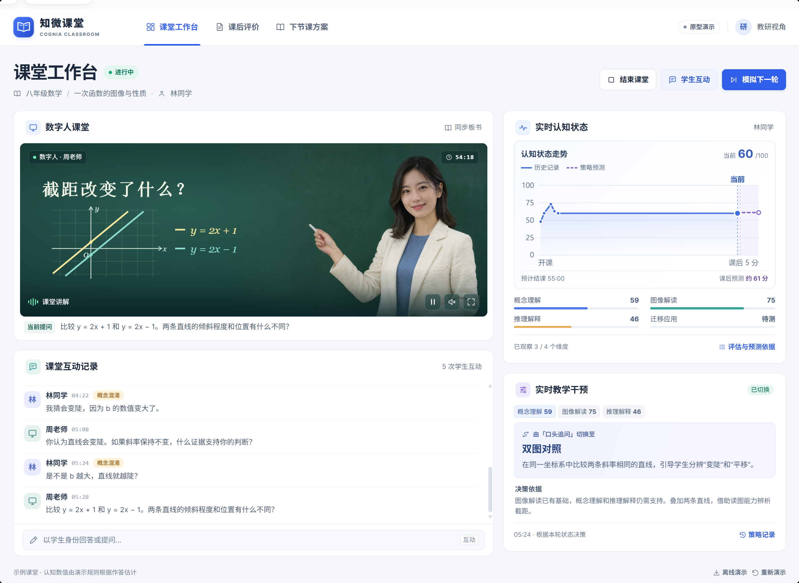
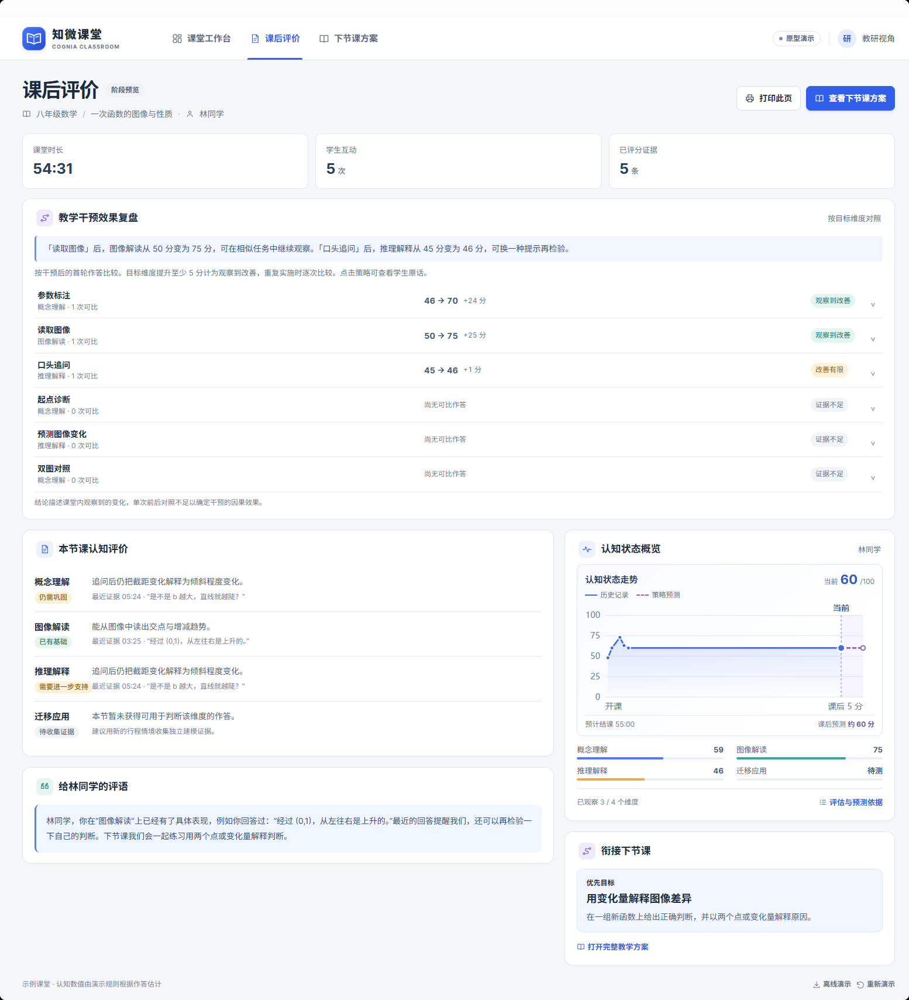
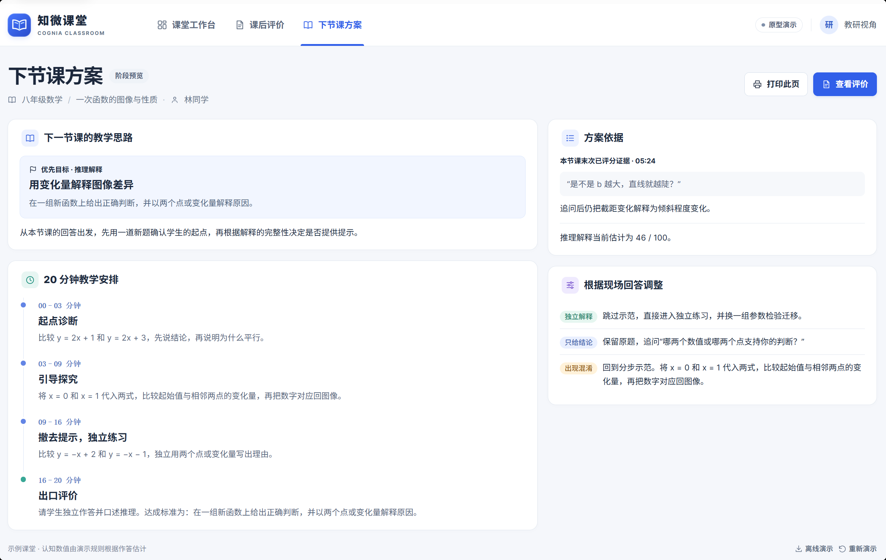

# 1、（current） 页面依照设计图调整

课堂工作台：

课后评价：

下节课方案：

网站站点为：知之课堂

## 开发描述

站点名称：**知之课堂- 课堂工作台**
页面状态：课堂【进行中】，当前课程示例：八年级数学《一次函数的图像与性质》，授课老师：林同学

> 
> 整体布局：**三栏流式卡片布局（左大右小），白色背景，浅灰分割，现代 B 端教育后台风格，主色调蓝色，卡片圆角、轻微阴影，清晰信息层级**
> 页面顶部导航栏（全局导航）：

- 左上角：品牌 Logo【知之课堂】
- 导航 Tab：课堂工作台（当前激活）｜课后评价｜下节课方案
- 右上角操作按钮组：原型演示、教研视角；还有【结束课堂】【学生互动】【模拟下一轮】功能按钮

页面主体区域分为：**左侧主内容区 + 右侧信息面板区**

## 左侧主内容区（占页面约 70% 宽度，上下 2 张独立卡片）

### 卡片 1：数字人课堂（核心授课区）

标题栏：数字人课堂，右上角【同步板书】按钮
卡片内部：

1. 顶部标签：数字人 - 周老师、计时（如 54:18）
2. 主播放容器（深色黑板绿背景，模拟线上黑板授课场景）：
   - 内嵌数字人讲师半身画面，讲师可做授课手势；黑板上展示教学板书内容（公式、坐标系、函数图像、标题文字）
   - 底部：课堂讲解状态条、**当前提问文本**（展示当前抛给学生的问题）
   - 视频底部控制栏：暂停、切帧、全屏播放控件

> 
> 对接说明：**数字人课堂模块保持现有对接逻辑不变，数字人 SDK / 推流、板书同步逻辑沿用当前方案，不改动对接模式**

### 卡片 2：课堂互动记录

标题栏：课堂互动记录，右上角标记互动条数（如 5 次学生互动）
内容为聊天式时序对话流，按时间倒序 / 正序展示师生对话：

- 每条消息包含：发言人（学生 / 老师）+ 时间戳 + 内容文本 + 学生状态标签（如「概念混淆」标签）
- 底部输入框：提示文字「以学生身份回答或提问...」+【互动】提交按钮，用于模拟学生输入、发起课堂交互

> 
> 业务说明：该模块承接数字人和学生之间一问一答的交互消息，是课堂对话链路的承载区域

## 右侧信息面板区（占页面约 30% 宽度，上下 2 张独立卡片，纵向堆叠）

### 卡片 1：实时认知状态

标题栏：实时认知状态，右上角：学生标识（林同学）
内部组件：

1. 认知状态走势折线图：
   - 图例：实线 = 历史记录，虚线 = 策略预测；横轴：开课→课后 5 分；纵轴 0-100 分值；标注【当前分数】、课后预测分数
   - 下方小字：预计结束课堂时间
2. 多维度认知分项进度条：概念理解、图像解读、推理解释、迁移应用（待 / 已观测标记）
3. 底部链接：评估与预测依据，展示已观测维度数量

### 卡片 2：实时教学干预

标题栏：实时教学干预，右上角状态标签【已切换】
内容区域：

- 干预触发来源（如：由「口头追问」切换至）
- 干预策略标题、干预说明文本（教学引导方案，如双图对照的教学思路）
- 决策依据文本：说明为什么触发这条干预策略
- 底部：策略记录链接，查看历史干预记录

## 交互 & 业务规则说明（给开发重点）

1. 数据流链路：数字人课堂抛出提问 → 学生在【课堂互动记录】回复消息 → 后端计算学生认知指标，更新【实时认知状态】图表 → 系统匹配规则，自动生成 / 切换【实时教学干预】策略
2. 模块锁定要求：**数字人课堂模块保持原有对接模式不变，仅 UI 布局和周边配套面板按该结构实现**
3. 视觉规范：
   - 风格：SaaS 教育 B 端，干净轻量化，无花哨动效；卡片圆角、浅阴影；主色 #1677ff（标准蓝）
   - 图表：ECharts/AntV 类折线图、横向进度条；
   - 标签：状态标签使用浅橙色 / 灰色小字标签，区分学生认知标签
4. 页面响应约定：优先桌面端工作台使用，不做移动端适配；固定左右分栏布局

当前 Tab：**课后评价（激活）**，其他导航：课堂工作台｜下节课方案
课程上下文：八年级数学 / 一次函数的图像与性质，学生：林同学
页面顶部右上角按钮：打印此页、查看下节课方案；全局右上角还有原型演示、教研视角

> 
> 整体风格：B 端教育 SaaS 后台，白底，卡片式布局，圆角浅阴影，主色蓝色，信息结构化，偏教研复盘、数据报告风格，桌面端优先。

## 顶部汇总信息行（3 个并排信息块）

1. 课堂时长：54:31
2. 学生互动：5 次
3. 已评分证据：5 条

## 左侧主区域（两大卡片纵向排列）

### 卡片 1：教学干预效果复盘

标题右侧小字：按目标维度对照
内容为干预复盘文本：描述上一轮教学干预策略、干预前后指标变化、观测结论；
下方是**参数标注对比表格**：
每行是一条干预策略（读取图像、口头追问、配点诊断、预测图像变化、双图对照），包含：

- 干预名称、触发次数
- 分数变化（原分 → 目标分 + 增量）
- 状态标签：**观测到改善 / 改善有限 / 证据不足**，带下拉箭头可展开详情

### 卡片 2：本节课认知评价

按 4 个认知维度分行展示：概念理解、图像解读、推理解释、迁移应用
每个维度结构统一：

- 维度标题 + 状态标签（仍需巩固 / 已有基础 / 需要进一步支持 / 待收集证据）
- 正文：记录学生课堂原话、典型作答、系统观测结论、后续采集建议

### 卡片 3：给林同学的评语

独立文本框，是面向学生的自然语言个性化评语，总结本节课优势、现存问题、下节课学习方向。

## 右侧面板（两张卡片纵向堆叠）

### 卡片 1：认知状态概览

右上角学生：林同学

1. 认知状态走势折线图：实线历史记录、虚线策略预测；0-100 纵轴，标注当前分数、课后预测分数、预计课堂结束时间
2. 分项进度条：概念理解、图像解读、推理解释、迁移应用，标注已观测维度数量
3. 链接：评估与预测依据

### 卡片 2：衔接下节课

- 优先目标标题
- 目标描述文本（本节课遗留缺口、下节课学习任务）
- 按钮：打开完整教学方案

## 页面底部全局按钮

右下角：离线演示、重新演示

## 业务数据流说明（给开发）

1. 数据来源：取自上一节课【课堂工作台】的实时认知、干预记录、师生对话证据
2. 作用：课后自动生成复盘报告，供老师教研、给学生反馈、自动生成下一节课预习 / 授课目标
3. 视觉细节：
   - 状态标签用差异化色标：绿色 = 观测改善、黄色 = 改善有限、灰色 = 证据不足
   - 文字区分：系统自动生成的推理文本 + 原始学生原话，方便老师溯源
   - 支持一键打印，适配纸质复盘、家校反馈
4. 和前一页【课堂工作台】联动关系：
   - 课堂工作台：实时上课、数字人授课、实时算认知、实时推送干预策略
   - 课后评价：上完课汇总全部证据、干预效果打分、生成学情评语、输出下节课目标

当前激活 Tab：**下节课方案**；顶部导航其余选项：课堂工作台、课后评价
课程上下文：八年级数学 / 一次函数的图像与性质，学生：林同学
页面右上角功能按钮：打印此页、查看评价；全局右上角：原型演示、教研视角
整体风格延续产品统一 B 端教研 SaaS 设计：白底、卡片圆角浅阴影、蓝色主色调，桌面端优先，布局为左右两栏卡片排版，承接【课后评价】输出的学情，自动生成后续授课教案。

## 左侧区域（两大纵向卡片）

### 卡片 1：下一节课的教学思路

- 优先目标：推理解释，标题【用变化量解释图像差异】
- 目标说明：在一组新函数上给出正确判断，并以两个点或变化量解释原因
- 教学思路文本：从本节课的回答出发，先用一道新题确认学生的起点，再根据解释的完整性决定是否提供提示。

### 卡片 2：20 分钟教学安排（时序课时拆解）

时间轴分段，带时间区间 + 阶段名称 + 教学任务：

1. 00–03 分钟｜起点诊断：比较 \(y=2x+1\) 和 \(y=2x+3\)，先说结论，再说明为什么平行。
2. 03–09 分钟｜引导探究：将 \(x=0\) 和 \(x=1\) 代入两式，比较起始值与相邻两点的变化量，再把数字对应回图像。
3. 09–16 分钟｜独立练习：撤去提示，独立练习；比较 \(y=-x+2\) 和 \(y=-x-1\)，独立用两个点或变化量写出理由。
4. 16–20 分钟｜出口评价：请学生独立作答并口述推理。达成标准：在一组新函数上给出正确判断，并以两个点或变化量解释原因。

## 右侧区域（两大纵向卡片）

### 卡片 1：方案依据

承载生成这份教案的学情证据，来自上一节课的课堂记录：

- 标注证据时间：本节课末次评分证据 05:24
- 原始学生问题原话：“是不是 b 越大，直线就越陡？”
- 学情总结：追问后仍把截距变化解释为倾斜程度变化
- 当前认知分值：推理解释当前估计为 46 / 100

### 卡片 2：根据现场回答调整（分支干预预案）

预设学生三种不同作答表现，配套差异化教学策略，带有状态标签：

- 【独立解释（绿色标签）】跳过示范，直接进入独立练习，并换一组参数检验迁移。
- 【只给结论（蓝色标签）】保留原题，追问 “哪两个数值或哪两个点支持你的判断？”
- 【出现混淆（黄色标签）】回到分步示范。将 \(x=0\) 和 \(x=1\) 代入两式，比较起始值与相邻两点的变化量，再把数字对应回图像。

## 页面底部

右下角：离线演示、重新演示

## 业务联动说明（给开发）

1. 数据链路：**课堂工作台（实时采集互动 + 认知分）→ 课后评价（汇总学情证据）→ 下节课方案（自动生成针对性教案、时间规划、课堂分支预案）**，三页面闭环。
2. 核心价值：基于单个学生的薄弱认知点，生成个性化短课时授课方案，并预置课堂分支，数字人授课时可以依据学生实时回答自动切换对应干预策略。
3. 视觉细节：不同分支预案使用颜色标签区分，时间分段使用圆点标识进度节点，可打印输出给教师备课使用。